# EcoTrack Pages

1. **Home**

   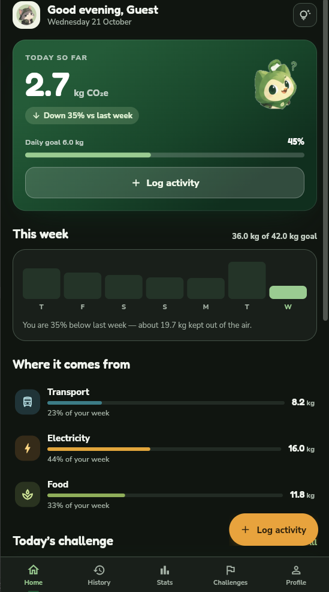

2. **History**

   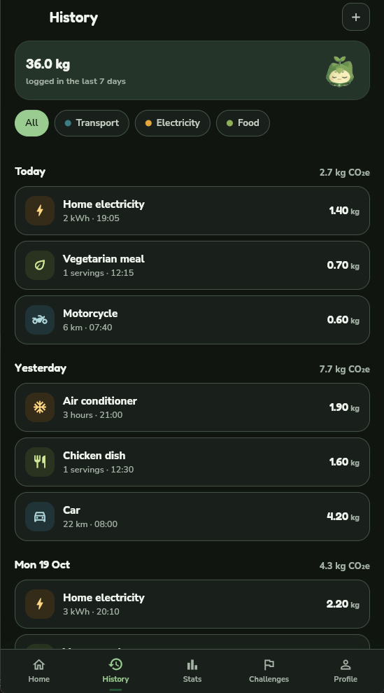

3. **Statistics**

   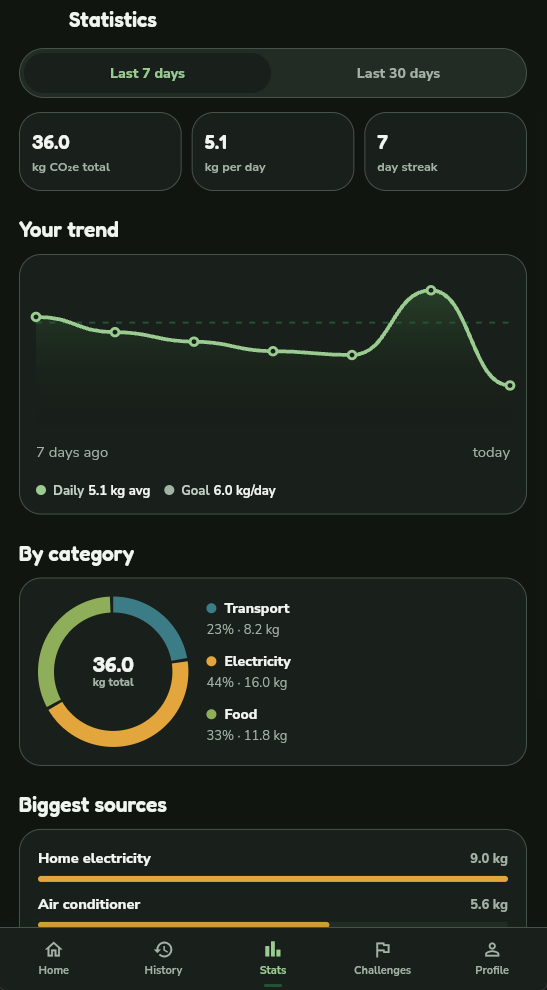

4. **Challenges**

   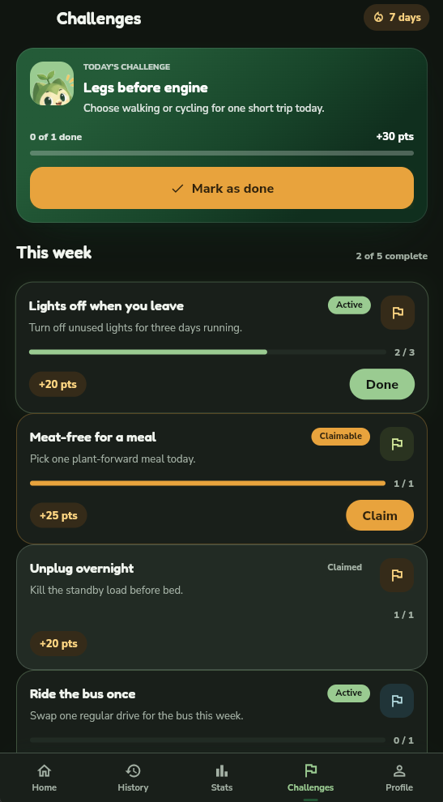

5. **Profile**

   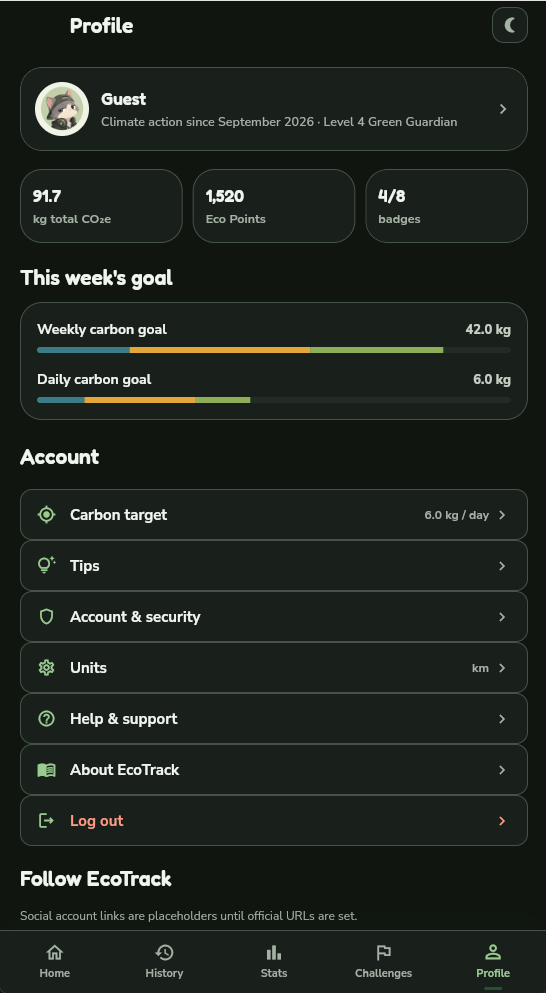

6. **Eco Tips**

   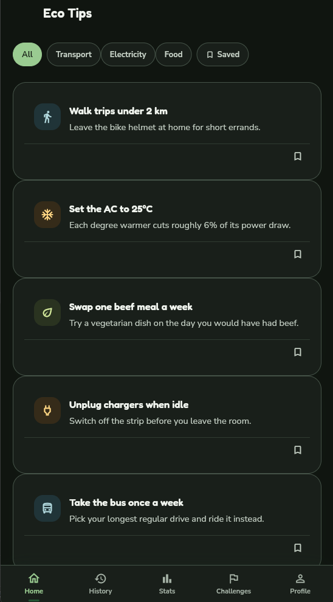

7. **Add Activity — Choose Category**

   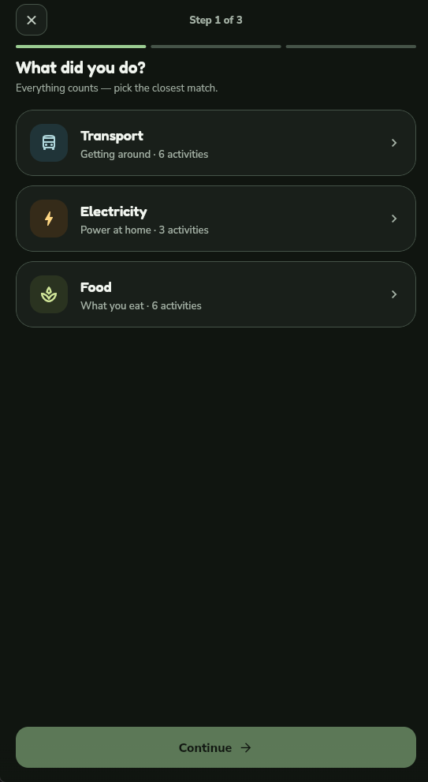

8. **Add Activity — Choose Activity**

   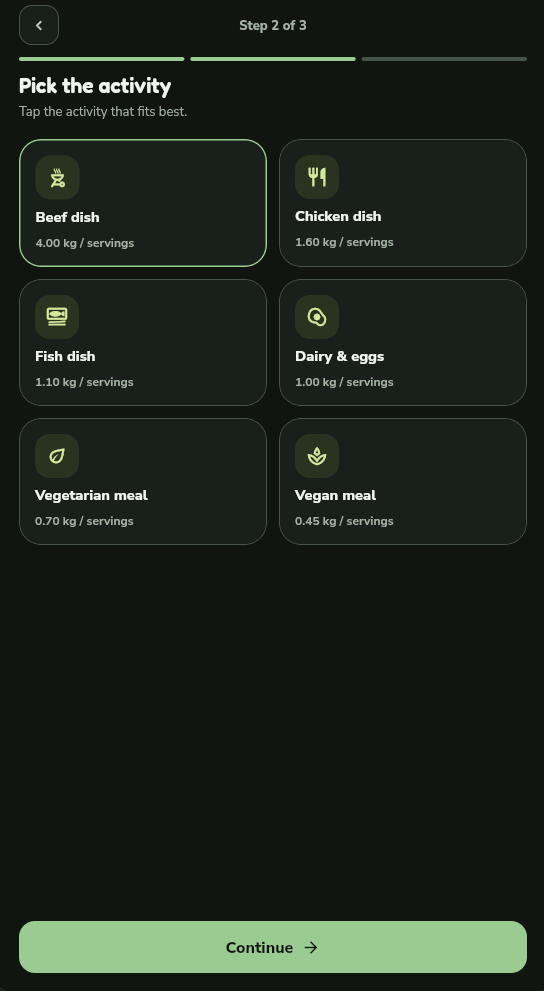

9. **Add Activity — Set Amount**

   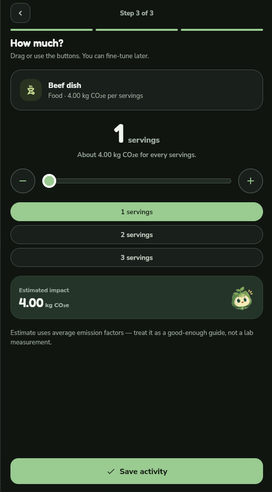

10. **Welcome / Onboarding**

    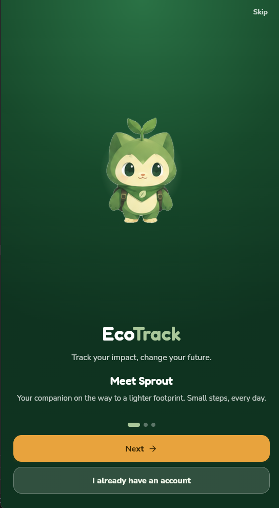

11. **Log In**

    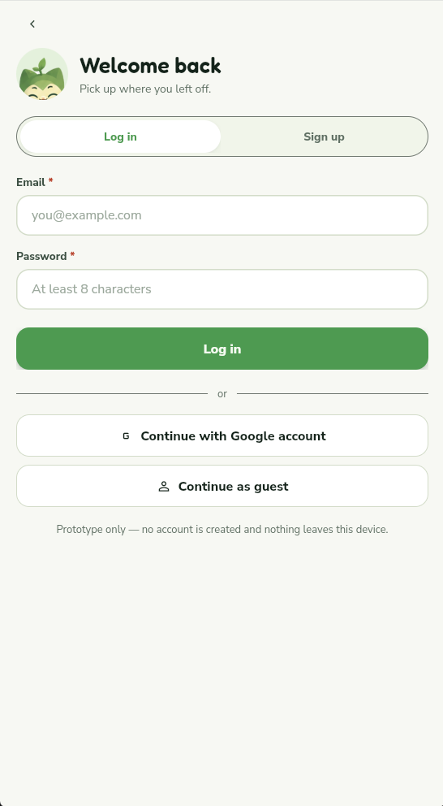

12. **Sign Up**

    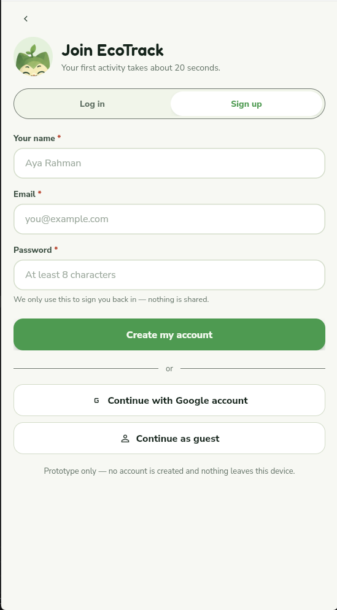
